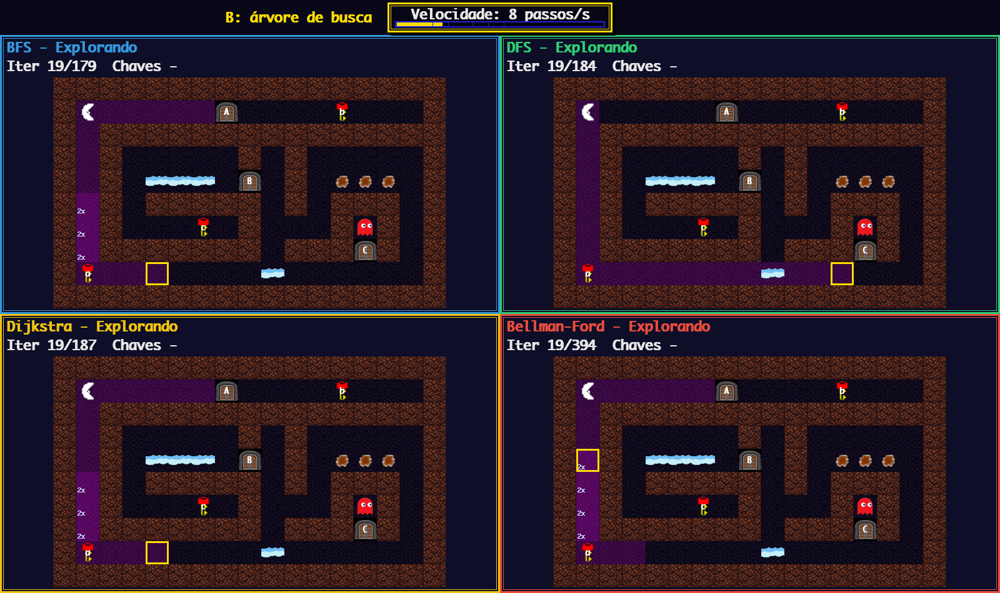
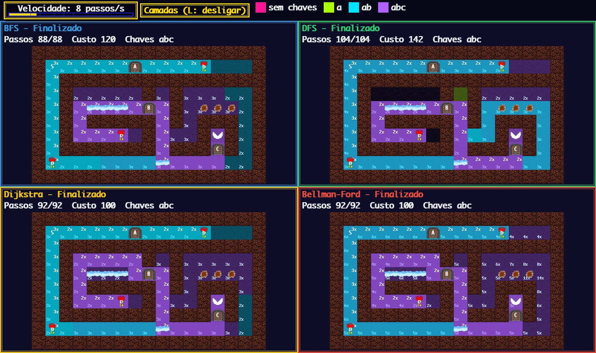
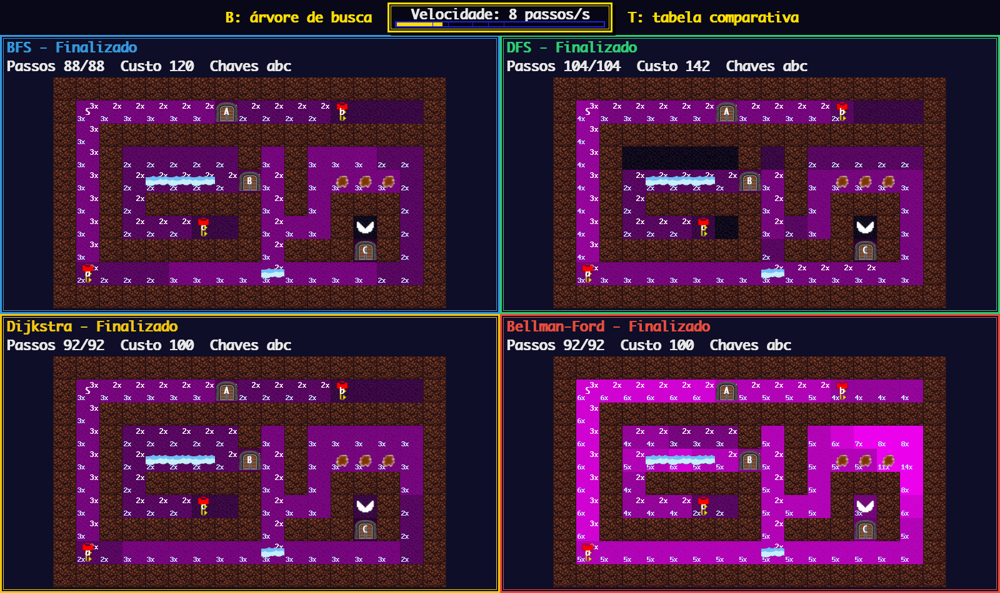
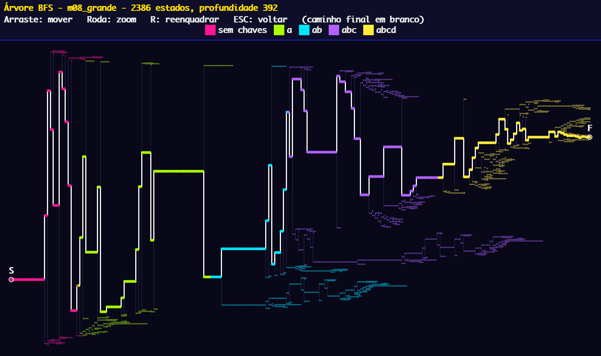
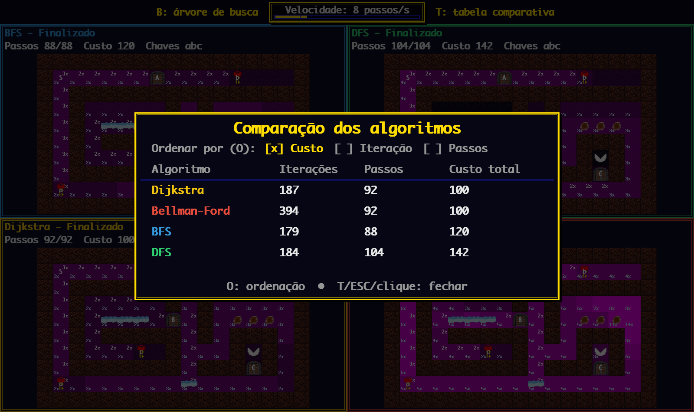

# Relatório — Parte 1: Labirinto com Chaves (Grafo de Estados)

Teoria dos Grafos — 2026.2

**Integrantes:**

- Amanda Luz
- Eric Albuquerque
- Mircio Ferreira
- Gabriel Aniceto
- Caio Almeida

**Orientadora:**

- Laura Alvez

---

## 1. Introdução

<!-- Problema, objetivo e visão geral do projeto. -->

- Descrição do problema: O jogador começa na casa `S` de um labirinto e precisa chegar à saída `G` pelo caminho de menor custo. O mapa tem paredes, que não podem ser atravessadas, e terrenos com custos diferentes. Há chaves, que o jogador pega ao entrar na casa e guarda para sempre, e portas, que só podem ser atravessadas por quem já tem a chave correspondente. Há também esteiras de mão única e casas de bônus. Como a mesma casa pode ser visitada com conjuntos de chaves diferentes, o mapa não pode ser tratado como o grafo: o problema é modelado como um grafo de estados, em que cada estado combina a posição, as chaves coletadas e os bônus já consumidos.
- Mapas utilizados: Os mapas `m01` a `m08` foram fornecidos pela orientadora como um desafio a ser debatido pelo grupo. Cada um exercita uma situação diferente: custos de terreno, uma ou três chaves, esteiras, bônus, fonte de energia, um mapa sem solução e um mapa grande. Além deles, o grupo criou mapas próprios a partir de um gerador de mapas. `m09` a `m11`
- Tabela de custos por terreno: A orientadora também indicou a tabela de custos abaixo, que não foi escolhida pelo grupo. O custo de um movimento é o custo da casa de destino.

| Símbolo | Terreno | Custo de entrar |
|---|---|---|
| `.` | Chão | 1 |
| `S` / `G` | Início / saída | 1 |
| `,` | Lama | 3 |
| `~` | Água | 5 |
| `a`–`d` | Chave | 1 |
| `A`–`D` | Porta (exige a chave correspondente) | 1 |
| `>` `<` `^` `v` | Esteira (só sai na direção da seta) | 1 |
| `+` | Bônus | −4 na primeira vez, 1 nas seguintes |
| `*` | Fonte de energia | −2 toda vez |
| `#` | Parede | intransponível |

## 2. Modelagem

<!-- O mapa não é o grafo. -->

- G_pos (grafo de posições): Matriz em que células adjacentes (N, L, S, O) são consideradas navegaveis caso cumpram as regras de navegação (ter a chave, não ser parede...)
- G_est (grafo de estados): É gerado dinamicamente durante a execução dos algoritmos de busca ao iterar pelo grafo de posições, também é gerado uma árvore de caminho reverso para cada mapa a fim de se encontrar o caminho mínimo.
- Rótulo do estado `(linha,coluna)|{chaves}|{bônus}`: Uma representação de uma célula durante a busca pelo menor caminho sobre as restrições e regras impostas pelo problema.
- Nó virtual ALVO: Posição final em que o algoritmo deve encontrar o caminho até ele.
- Por que o grafo é dirigido (esteiras, coleta de chave): Após o algoritmo passar por determinadas células ela apenas pode navegar em uma direção sem poder voltar no estado anterior, a mais clara é no chão direcionado mas o mesmo também ocorre quando é pego uma chave ou numa célula bonûs (+)

## 3. Estruturas de dados

<!-- Tabela hash (dict) e conjunto (set). -->

| Estrutura | Onde é usada | Por que foi escolhida | Custo |
|---|---|---|---|
| Tabela hash (`dict`) | (Árvores de caminho reverso, menor custo encontrado, outros subproblemas envolvendo chave valor) por estados | Menor complexidade de inserção e busca  | Busca, escrita, O(1), Iterar O(n) |
| Conjunto (`set`) | Estados visitados | Menor complexidade de inserção e busca | Busca, escrita, O(1), Iterar O(n) |
| Pilha (`list`) | dfs, backtraking | base do algoritmo de dfs | Push O(1), Pop O(1) |
| Fila (`deque`) | Bfs, Mapa de distância | base do algoritmo de bfs | Enqueue O(1) Dequeue O(1) |
| Fila de prioridade (`heapq`) | Dijstra, A*, Prim | Uso de fila de prioridade | Enqueue O(log(n)) Dequeue O(log(n)) |
| Disjoint Set (`DisjointSet`) | Kruskal | União de conjuntos + consulta | Complexidade O(1) |

- Representação do estado (`MapState`): ((x, y), {keys}, {bonus_visited})
- Representação do grafo (lista de adjacência): list[MapState]
- Exploração a partir do estado inicial, sem gerar todas as combinações: [PREENCHER]

## 4. Gerador de mapas

<!-- Código: src/map/map_generator.py e src/gerar_mapa.py -->

- Etapas da geração (`generate_map`): o gerador monta o mapa em etapas, sempre nesta ordem:
  1. Constrói o labirinto base com a estratégia escolhida. Altura e largura são forçadas a ímpar (`rows |= 1`, `cols |= 1`), e o resultado é uma grade de paredes e corredores, cercada por parede.
  2. Cria ciclos (`generate_loops`): remove paredes internas com probabilidade `braid_factor`. Com 0 o labirinto fica "perfeito" (um único caminho entre duas casas); valores maiores abrem caminhos alternativos.
  3. Sorteia a posição de `S` entre as casas de coordenadas ímpares.
  4. Faz uma BFS a partir de `S` (`get_cells_by_distance`) e guarda as casas na ordem em que são alcançadas, da mais perto para a mais longe.
  5. Distribui as chaves e portas (`generate_key_port`).
  6. Escolhe a posição de `G` (`get_worst_cell`): faz uma BFS sobre pares (posição, chaves coletadas) e escolhe a casa mais distante de `S`, em número de passos, já respeitando as portas.
  7. Distribui as esteiras (`generate_floor_direct`) e os demais terrenos (`generate_floor_variation`).
  8. Calcula as estatísticas do mapa (`compute_stats`), como a contagem de cada tipo de casa.
- Estratégias do labirinto (parâmetro `strategy`):
  - `backtracking`: busca em profundidade com pilha. Parte de uma casa ímpar sorteada, anda de 2 em 2 para um vizinho ainda não visitado, abre a parede do meio e volta atrás quando não há vizinho livre.
  - `recursive_division`: começa com uma sala aberta e a divide recursivamente por paredes, deixando uma passagem em cada parede. Escolhe a direção do corte conforme a proporção da área (vertical se for mais larga do que alta).
  - `kruskal`: cada casa ímpar é um nó e cada parede entre duas casas vizinhas é uma aresta candidata. As arestas são embaralhadas, e a parede só é aberta se as duas casas ainda estiverem em conjuntos diferentes. A verificação usa a estrutura de conjuntos disjuntos (`DisjointSet`, com compressão de caminho e união por rank).
  - `prim`: parte de uma casa sorteada e mantém uma lista de arestas de fronteira. Sorteia uma delas e, se a casa de destino ainda não foi visitada, abre a parede e acrescenta as novas arestas.
- Distribuição de chaves e portas (`generate_valid_sequence`, `generate_key_port`): primeiro sorteia uma sequência em que cada porta só aparece depois da sua chave. Depois coloca os elementos da sequência em posições igualmente espaçadas ao longo da lista da BFS (passo = total de casas ÷ (tamanho da sequência + 2)). Assim as chaves ficam mais perto de `S`, as portas mais longe, e uma chave nunca fica atrás da própria porta. As letras vêm do parâmetro `keys`, e cada chave cria a porta correspondente.
- Esteiras, água, lama, bônus e fonte:
  - Esteiras (`floor_directed_density`): só são colocadas sobre casas de chão comum. As casas por onde passa o caminho de `S` até `G` recebem a direção desse caminho. As que ficam fora do caminho recebem uma direção sorteada entre os vizinhos que não são parede. Casas que o caminho cruza mais de uma vez não recebem esteira.
  - Água, lama, bônus e fonte (`water_density`, `mud_density`, `bonus_density`, `source_density`): cada casa de chão comum sorteia um número entre 0 e 1 e vira um desses terrenos conforme as faixas acumuladas das densidades. A soma de todas as densidades não pode passar de 1, senão o gerador levanta `ValueError`.
- Parâmetros (`GENERATOR_PARAMS`, em `src/gerar_mapa.py`):

| Parâmetro | Significado | Exemplo de entrada |
|---|---|---|
| `rows`, `cols` | tamanho do mapa (linhas × colunas) | 15 × 11 |
| `strategy` | algoritmo que gera o labirinto | `backtracking` |
| `keys` | chaves do mapa; cada uma cria a porta correspondente | `a`, `b`, `c` |
| `braid_factor` | fração de paredes removidas para criar ciclos (0 a 1) | 0.00 |
| `water_density` | fração de casas de água | 0.03 |
| `mud_density` | fração de casas de lama | 0.03 |
| `source_density` | fração de casas de fonte | 0.0 |
| `bonus_density` | fração de casas de bônus | 0.01 |
| `floor_directed_density` | fração de esteiras direcionadas | 0.20 |


### 4.1 Mapas do grupo

Além dos mapas `m01` a `m08` fornecidos pela orientadora, o grupo trabalhou com três mapas extras. Eles foram gerados pelo gerador descrito acima e depois editados à mão: foram colocadas casas de bônus (`+`) e esteiras (`>`, `<`, `^`, `v`) para criar os estados-armadilha.

| Mapa | Arquivo | Origem |
|---|---|---|
| m09 | [`m09_gerado_01.txt`](maps/m09_gerado_01.txt) | gerado por `src/gerar_mapa.py` e editado à mão (bônus e esteiras) |
| m10 | [`m10_gerado_02.txt`](maps/m10_gerado_02.txt) | gerado por `src/gerar_mapa.py` e editado à mão (bônus e esteiras) |
| m11 | [`m11_gerado_extra.txt`](maps/m11_gerado_extra.txt) | gerado por `src/gerar_mapa.py` e editado à mão (bônus e esteiras) |

Requisitos do enunciado para os mapas do grupo: (1) ao menos 3 chaves, esteiras e bônus, com o caminho de menor custo coletando um bônus e passando por uma esteira; (2) um mapa armadilha, com pelo menos 20% dos estados alcançáveis sendo estados-armadilha.

#### Gabarito

O gabarito de cada mapa é o caminho encontrado por cada algoritmo, escrito como a lista de posições `(linha, coluna)` de `S` até `G`. Ele foi gerado com os cinco algoritmos (A*, Bellman-Ford, BFS, DFS e Dijkstra) por `src/metrics/map_solution.py`, e cada algoritmo tem a sua pasta:

| Algoritmo | Pasta | Arquivo do m09 | Arquivo do m10 | Arquivo do m11 |
|---|---|---|---|---|
| A* | [`out/parte1/gabarito_mapa_gerado/astar/`](out/parte1/gabarito_mapa_gerado/astar/) | [`gabarito_m09_gerado_01.txt`](out/parte1/gabarito_mapa_gerado/astar/gabarito_m09_gerado_01.txt) | [`gabarito_m10_gerado_02.txt`](out/parte1/gabarito_mapa_gerado/astar/gabarito_m10_gerado_02.txt) | [`gabarito_m11_gerado_extra.txt`](out/parte1/gabarito_mapa_gerado/astar/gabarito_m11_gerado_extra.txt) |
| Bellman-Ford | [`out/parte1/gabarito_mapa_gerado/bellman_ford/`](out/parte1/gabarito_mapa_gerado/bellman_ford/) | [`gabarito_m09_gerado_01.txt`](out/parte1/gabarito_mapa_gerado/bellman_ford/gabarito_m09_gerado_01.txt) | [`gabarito_m10_gerado_02.txt`](out/parte1/gabarito_mapa_gerado/bellman_ford/gabarito_m10_gerado_02.txt) | [`gabarito_m11_gerado_extra.txt`](out/parte1/gabarito_mapa_gerado/bellman_ford/gabarito_m11_gerado_extra.txt) |
| BFS | [`out/parte1/gabarito_mapa_gerado/bfs/`](out/parte1/gabarito_mapa_gerado/bfs/) | [`gabarito_m09_gerado_01.txt`](out/parte1/gabarito_mapa_gerado/bfs/gabarito_m09_gerado_01.txt) | [`gabarito_m10_gerado_02.txt`](out/parte1/gabarito_mapa_gerado/bfs/gabarito_m10_gerado_02.txt) | [`gabarito_m11_gerado_extra.txt`](out/parte1/gabarito_mapa_gerado/bfs/gabarito_m11_gerado_extra.txt) |
| DFS | [`out/parte1/gabarito_mapa_gerado/dfs/`](out/parte1/gabarito_mapa_gerado/dfs/) | [`gabarito_m09_gerado_01.txt`](out/parte1/gabarito_mapa_gerado/dfs/gabarito_m09_gerado_01.txt) | [`gabarito_m10_gerado_02.txt`](out/parte1/gabarito_mapa_gerado/dfs/gabarito_m10_gerado_02.txt) | [`gabarito_m11_gerado_extra.txt`](out/parte1/gabarito_mapa_gerado/dfs/gabarito_m11_gerado_extra.txt) |
| Dijkstra | [`out/parte1/gabarito_mapa_gerado/dijkstra/`](out/parte1/gabarito_mapa_gerado/dijkstra/) | [`gabarito_m09_gerado_01.txt`](out/parte1/gabarito_mapa_gerado/dijkstra/gabarito_m09_gerado_01.txt) | [`gabarito_m10_gerado_02.txt`](out/parte1/gabarito_mapa_gerado/dijkstra/gabarito_m10_gerado_02.txt) | [`gabarito_m11_gerado_extra.txt`](out/parte1/gabarito_mapa_gerado/dijkstra/gabarito_m11_gerado_extra.txt) |

Os mesmos arquivos existem para `m01` a `m08`, com duas exceções. O `m07` não tem arquivo em nenhuma pasta, porque o mapa não tem solução. O `m06` não tem arquivo no Bellman-Ford (que detecta o ciclo negativo e levanta erro) nem no Dijkstra (que não termina nesse mapa).

## 5. Algoritmos

<!-- Código: src/solver/ -->

| Algoritmo | Critério | Estrutura | Complexidade |
|---|---|---|---|
| BFS | Menor número de passos (arestas), sem olhar o custo. Expande os estados por nível, do mais perto ao mais longe de `S`. | Fila FIFO (`deque`) e tabela hash (`dict`) de predecessores, que também marca os estados já visitados. | O(V + E) |
| DFS | Segue um caminho até o fim antes de voltar. Devolve o primeiro caminho que encontra, sem garantia de ser o menor. | Pilha LIFO (`list`) e tabela hash (`dict`) de predecessores. | O(V + E) |
| Dijkstra | Menor custo acumulado desde `S`. Sempre expande o estado de menor custo conhecido. | Fila de prioridade (`heapq`, min-heap) e tabela hash (`dict`) com o melhor custo e o predecessor de cada estado. | O((V + E) log V) |
| Bellman-Ford | Menor custo acumulado, relaxando todas as arestas em até V − 1 rodadas. Uma rodada extra detecta ciclo negativo. | Conjunto (`set`) de todos os estados alcançáveis, obtido por exploração prévia, e tabela hash (`dict`) com custos e predecessores. | O(V · E) |
| A* | Menor custo, guiado por uma estimativa. A prioridade é custo acumulado + heurística (distância de Manhattan até `G`). | Fila de prioridade (`heapq`) e tabela hash (`dict`) com o melhor custo e o predecessor. | O((V + E) log V) no pior caso, o mesmo do Dijkstra. |

V e E são o número de estados e de arestas do grafo de estados (G_est) alcançável a partir de `S`.

### 5.1 Discussões obrigatórias

- m01 — por que BFS e Dijkstra dão caminhos diferentes: 

O BFS busca o caminho mais curto em distância, isto é, com o menor número de passos, e não considera o custo de cada casa. O Dijkstra busca o caminho de menor custo, somando o custo de cada casa de destino. No `m01` existem dois caminhos possíveis de `S` até `G`, e eles passam por terrenos diferentes. O caminho de cima atravessa 5 casas de água (custo 5 cada) e o de baixo atravessa 3 casas de lama (custo 3 cada). O caminho de cima é o menor do ponto de vista da distância (10 passos), mas é o maior em custo (30). O caminho de baixo é o maior do ponto de vista da distância (14 passos), mas é o menor em custo (20). Por isso o BFS escolhe o caminho de cima, e o Dijkstra escolhe o de baixo, e os caminhos gerados são diferentes.


- m05 — por que o G_est não tem ciclo negativo: 

O mapa 05 não tem ciclo negativo porque não existe custo negativo permanente, apenas o do bônus. Na primeira vez que o jogador entra no bônus, o custo é negativo, mas depois disso o custo passa a ser positivo. Depois que um estado gera o bônus, ele é dado como visitado e não pode mais gerar um ciclo negativo. O ciclo negativo só seria possível se o custo negativo fosse permanente, como o da fonte de energia (`*`), que vale −2 toda vez que o jogador entra nela.


- m06 — ciclo negativo e correção da regra da fonte: 

O mapa 06 tem ciclo negativo por causa da fonte de energia (`*`), cujo custo é −2 de forma permanente, toda vez que o jogador entra nela. A fonte está na linha 3, coluna 5, e a casa anterior a ela é a da linha 3, coluna 4 (custo 1). O jogador pode sair da casa anterior para a fonte e voltar, e cada ida e volta custa −2 + 1 = −1. Como isso pode se repetir indefinidamente, o custo sempre diminui, e algoritmos como o Dijkstra entram num ciclo infinito, indo e voltando entre as duas casas. Para detectar, há abordagens simples, e uma delas é verificar se o número de arestas de um caminho excede o teto teórico, que é casas livres × 2^(nº de chaves) × 2^(nº de bônus). Se exceder, houve um problema de ciclo, pois um caminho sem ciclo nunca teria mais arestas do que o número de estados. Para corrigir a regra é possivel alterar a regra para que funciona de forma similar ao do bonus onde só a primeira visita é negativa, outra forma é somar todos +2 para todos as demais posições.

- m07 — por que não há solução e quantos estados são alcançáveis: 

O mapa 07 não tem solução porque a chave (`a`) que destrava a porta (`A`) está atrás dela, e por isso é impossível ultrapassá-la. A ausência de solução é detectada pela busca: quando não resta mais nenhum estado para explorar e a saída (`G`) não foi alcançada, conclui-se que não é possível chegar nela. O mapa não tem nenhum terreno especial que possa gerar estados diferentes para a mesma casa, como bônus ou chaves alcançáveis na prática. Por isso as posições alcançáveis têm sempre o mesmo conjunto de chaves e de bônus (vazio), e o grafo de estados alcançável se comporta como o grafo de posições. São 16 posições alcançáveis dentro de um estado.

### 5.2 Estados-armadilha

- Definição e como são calculados: Estado-armadilha é um estado alcançável a partir de `S` do qual a saída (`G`) não pode mais ser alcançada. Existem duas formas de ele surgir:
  1. Por esteira. A esteira obriga o jogador a sair na direção da seta, e só permite entrar por qualquer lado. Se a seta aponta para uma parede ou para um trecho sem saída, o jogador não consegue voltar, porque o único movimento permitido é o da seta. Exemplos simples, em que `J` é o jogador:

     ```
     J . . . > . #       depois da esteira o jogador só anda para a direita e nunca mais volta
     # < J . . . G #     se o jogador entrar na esteira, ela aponta para a parede e ele fica preso
     ```

  2. Por chave atrás da própria porta, como no `m07`: a chave que abre a porta está depois dela, então a porta nunca é aberta e tudo o que está depois dela é inalcançável.

  A detecção segue a mesma ideia nos dois casos: o estado entra numa região da qual não há como sair em direção à saída e não é possível retornar. Para calcular, explora-se o grafo de estados a partir de `S` e marcam-se os estados que não conseguem chegar à saída. Isso pode ser feito buscando a partir da saída no grafo com os arcos invertidos (grafo transposto): os estados alcançáveis a partir de `S` que não aparecem nessa busca são os estados-armadilha.

  Para ser armadilha, importa o estado inteiro (posição e chaves), e não só a posição. No `m04` há dois casos. O primeiro é quando o jogador entra na primeira esteira para cima (`^`): ela aponta para a parede, então ele não tem para onde ir e não pode voltar. O segundo é quando o jogador entra na esteira `>` perto da porta sem a chave: a esteira o empurra para a direita, e a porta `A` fica bloqueada, então ele fica indo e voltando entre as mesmas casas. Na mesma esteira `>`, com a chave, o jogador consegue abrir a porta e chegar à saída, então esse estado deixa de ser armadilha.
- Resultados (m04, m07): No `m07` não há solução, porque todo estado alcançável é armadilha. São 16 posições alcançáveis dentro de um estado, todas sem chaves, e nenhuma delas chega à saída. Como só existem essas posições, não há outro caminho a explorar. No `m04` há 37 estados alcançáveis e 4 são armadilha (10,8%). Um deles é a esteira `^` da linha 1, coluna 3, que aponta para a parede (aparece em dois estados, com e sem a chave `a`). Os outros dois estão na linha 1, colunas 8 e 9: são a última esteira `>` e a casa ao lado da porta `A`, e são armadilha apenas quando o jogador não tem a chave. Mesmo que alguns estados morram, existem outros estados no mapa, e é possível navegar por eles até a saída, por isso o `m04` tem solução.

## 6. Métricas

<!-- Código: src/metrics/graph_metrics.py e src/metrics/state_degrees.py -->

As métricas são calculadas para os dois grafos de cada mapa: o grafo de posições (G_pos) e o grafo de estados (G_est). Ambos são dirigidos. V é o conjunto de vértices e E é o conjunto de arcos.

| Métrica | Definição | Como é calculada |
|---|---|---|
| Ordem | Número de vértices do grafo, \|V\|. No G_pos são as casas alcançáveis a partir de `S`. No G_est são os estados alcançáveis. | Tamanho do dicionário de adjacência (`len(adj)`), construído por exploração a partir do início. Só entram vértices alcançáveis. |
| Tamanho | Número de arcos do grafo, \|E\|. Cada movimento permitido de um vértice para outro é um arco, sem espelhamento. | Soma dos tamanhos das listas de vizinhos de todos os vértices. |
| Densidade | Fração dos arcos possíveis que existem de fato. Num grafo dirigido, o máximo é \|V\|(\|V\| − 1). | `\|E\| / (\|V\| · (\|V\| − 1))`. Se \|V\| < 2, vale 0. |
| Teto teórico | Máximo de vértices que o grafo poderia ter se todas as combinações fossem possíveis. No G_pos é o número de casas livres. No G_est é casas livres × 2^(nº de chaves) × 2^(nº de bônus). | Conta as casas que não são parede, as chaves e os bônus do mapa, e aplica a fórmula. |
| Taxa de ocupação | Fração do teto teórico que é realmente alcançável. | `\|V\| / teto`. |
| Grau de entrada | Número de arcos que chegam a um vértice. | Para cada arco `u → v`, soma 1 ao grau de entrada de `v`. |
| Grau de saída | Número de arcos que saem de um vértice. | Tamanho da lista de vizinhos do vértice. |

O cálculo está em `src/metrics/graph_metrics.py` (ordem, tamanho, densidade, teto e ocupação) e em `src/metrics/state_degrees.py` (graus). Em um grafo dirigido, a soma dos graus de entrada é igual à soma dos graus de saída e igual ao tamanho, o que o código confere com um `assert`.

### 6.1 Resultados por mapa

| Mapa | Ordem G_pos | Tamanho G_pos | Densidade G_pos | Ordem G_est | Tamanho G_est | Densidade G_est | Teto | Ocupação |
|---|---|---|---|---|---|---|---|---|
| m01_terreno | 24 | 48 | 0.0870 | 24 | 48 | 0.0870 | 24 | 100.0% |
| m02_uma_chave | 23 | 44 | 0.0870 | 39 | 75 | 0.0506 | 46 | 84.8% |
| m03_tres_chaves | 76 | 168 | 0.0295 | 213 | 467 | 0.0103 | 608 | 35.0% |
| m04_esteiras | 20 | 36 | 0.0947 | 37 | 67 | 0.0503 | 48 | 77.1% |
| m05_bonus | 44 | 92 | 0.0486 | 340 | 712 | 0.0062 | 352 | 96.6% |
| m06_fonte | 24 | 48 | 0.0870 | 24 | 48 | 0.0870 | 24 | 100.0% |
| m07_impossivel | 25 | 56 | 0.0933 | 16 | 38 | 0.1583 | 62 | 25.8% |
| m08_grande | 1169 | 2576 | 0.0019 | 2919 | 6366 | 0.0007 | 18704 | 15.6% |
| m09_gerado_01 | 66 | 123 | 0.0287 | 259 | 471 | 0.0070 | 8832 | 2.9% |
| m10_gerado_02 | 51 | 94 | 0.0369 | 184 | 337 | 0.0100 | 4416 | 4.2% |
| m11_gerado_extra | 66 | 118 | 0.0275 | 96 | 173 | 0.0190 | 2240 | 4.3% |

O teto e a ocupação são os do grafo de estados: teto = casas livres × 2^(nº de chaves) × 2^(nº de bônus), e ocupação = ordem do G_est ÷ teto. Os valores vêm do arquivo [`out/parte1/metricas_grafos.txt`](out/parte1/metricas_grafos.txt), gerado por `python -m src.metrics.graph_metrics`.


### 6.2 Graus e multiplicidade

- Graus de entrada e de saída: O grau de saída de um estado é o número de arcos que saem dele, isto é, para quantos estados o jogador pode ir a partir dele. O grau de entrada é o número de arcos que chegam a ele. Os graus são calculados por `degrees()` e gravados por `state_degrees_csv()`, ambos em [`src/metrics/state_degrees.py`](src/metrics/state_degrees.py). O grafo de estados vem de `state_graph()`, que explora a partir do estado inicial. O grau de saída é o tamanho da lista de vizinhos de cada estado, e o grau de entrada é obtido percorrendo todos os arcos `u → v` e somando 1 ao grau de `v`. Para cada mapa, o resultado é gravado em `out/parte1/graus/graus_<mapa>.csv`, com uma linha por estado.

  Exemplo, as primeiras linhas de [`graus_m02_uma_chave.csv`](out/parte1/graus/graus_m02_uma_chave.csv). A posição está no formato `x,y`, e `-` indica que o campo está vazio (sem chaves ou sem bônus).

  | Posição (x,y) | Chaves | Bônus visitados | Grau de entrada | Grau de saída |
  |:---:|:---:|:---:|:---:|:---:|
  | 1,1 | - | - | 2 | 2 |
  | 1,1 | a | - | 2 | 2 |
  | 1,2 | - | - | 2 | 2 |
  | 1,2 | a | - | 2 | 2 |
  | 1,3 | - | - | 2 | 2 |

  A mesma posição aparece em duas linhas, uma sem chaves e outra com a chave `a`, porque são estados diferentes do grafo.


## 7. Testes

### 7.1 Como executar

```bash
python3 -m pytest test/map_loader test/test_algorithms -v
```

### 7.2 Casos testados

| Grupo | Caso | Resultado esperado | Resultado |
|---|---|---|---|
| map_loader (leitura) | (1) tamanho do mapa (linhas e colunas)<br>(2) cada símbolo simples vira o tipo certo de casa (`#`, `S`, `.`, `,`, `~`, `+`, `*`, `G`)<br>(3) chaves e portas<br>(4) as 4 esteiras (`>`, `<`, `v`, `^`) | (1) 3 linhas e 5 colunas, como no arquivo<br>(2) cada posição tem o tipo de casa correspondente ao símbolo<br>(3) chave vira `MapKey` e porta vira `MapPort`, com a letra da chave em minúscula<br>(4) cada esteira tem o vetor de direção certo, com o eixo y crescendo para baixo | 4 testes passaram (`test/map_loader/test_successful_read_map.py`) |
| map_loader (ida e volta) | (1) mapa com vários tipos de casa é salvo com `map_save` e carregado de novo | (1) o mapa recarregado tem o mesmo início, a mesma saída e as mesmas casas do original | 1 teste passou (`test/map_loader/test_integration_map_save.py`) |
| map_loader (importação) | (1) mapa em texto puro<br>(2) mapa dentro de bloco de código (` ``` `)<br>(3) linhas em branco e linguagem do bloco de código<br>(4) sem início ou sem saída<br>(5) símbolo inválido<br>(6) linhas de tamanhos diferentes<br>(7) arquivo vazio<br>(8) salvar em `maps/update/` e recarregar<br>(9) não sobrescrever um mapa existente | (1) o mapa é lido com as dimensões, o início e a saída certos<br>(2) o bloco de código é ignorado<br>(3) as linhas em branco e a linguagem são ignoradas<br>(4) levanta `ValueError`<br>(5) levanta `ValueError`<br>(6) levanta `ValueError`<br>(7) levanta `ValueError`<br>(8) o arquivo é gravado e o mapa recarregado é igual ao original<br>(9) um nome já existente não é substituído | 9 testes passaram (`test/map_loader/test_map_import.py`) |
| BFS | (1) mapa simples com um único caminho<br>(2) objetivo inalcançável<br>(3) mapa aberto, com vários caminhos<br>(4) porta trancada com a chave em outro ponto<br>(5) caminho com água e caminho mais longo e mais barato | (1) caminho válido de `S` até `G`, com cada passo permitido<br>(2) caminho vazio<br>(3) caminho com o menor número de passos<br>(4) a mesma casa aparece em dois estados, sem a chave e com ela<br>(5) o BFS escolhe o caminho com menos passos, mesmo sendo mais caro | 5 testes passaram (`test/test_algorithms/test_bfs.py`) |
| DFS | (1) mapa simples com um único caminho<br>(2) objetivo inalcançável<br>(3) porta trancada com a chave em outro ponto<br>(4) árvore de predecessores da busca | (1) caminho válido de `S` até `G`, com cada passo permitido<br>(2) caminho vazio<br>(3) a mesma casa aparece em dois estados, sem a chave e com ela<br>(4) o início não tem predecessor, nenhum estado é expandido duas vezes, e cada predecessor leva ao estado por um arco permitido | 4 testes passaram (`test/test_algorithms/test_dfs.py`) |
| Dijkstra | (1) mapa simples com um único caminho<br>(2) objetivo inalcançável<br>(3) caminho com água e desvio mais barato<br>(4) porta trancada com a chave em outro ponto | (1) caminho válido de `S` até `G`, com cada passo permitido<br>(2) caminho vazio<br>(3) custo total 7, com o desvio que evita a água<br>(4) a mesma casa aparece em dois estados, sem a chave e com ela | 4 testes passaram (`test/test_algorithms/test_dijkstra.py`) |
| Bellman-Ford | (1) mapa simples com um único caminho<br>(2) objetivo inalcançável<br>(3) bônus com custo negativo no caminho<br>(4) ciclo negativo alcançável (fonte `*`)<br>(5) porta trancada com a chave em outro ponto | (1) caminho válido de `S` até `G`, com cada passo permitido<br>(2) caminho vazio, sem mensagem de erro<br>(3) caminho de menor custo, que passa pelo bônus, com custo total −1<br>(4) nenhum caminho é devolvido e o solver devolve uma mensagem<br>(5) a mesma casa aparece em dois estados, sem a chave e com ela | 5 testes passaram (`test/test_algorithms/test_bellman_ford.py`) |


## 8. Visualizações

### 8.1 Algoritmos escolhidos

- Na interface gráfica é possível escolher 4 algoritmos e compará-los ao mesmo tempo, em quadrantes, assistindo à solução de cada um no mesmo mapa. Os 4 algoritmos obrigatórios do enunciado são BFS, DFS, Dijkstra e Bellman-Ford. Além deles, o grupo implementou, de forma extra e como uma brincadeira, outros algoritmos que também aparecem no menu: A*, BFS Wall, A* Hack, Random Walk e Portal Solver.



### 8.2 Heatmap das camadas



*Figura: mapa `m03` com a opção de cor por camada (`L`) ligada. Cada cor é um conjunto de chaves (sem chaves, `a`, `ab`, `abc`), nos quatro algoritmos.*

- O que mostra: O mapa com cada algoritmo em um quadrante, colorido pelas chaves que o jogador tinha em cada parte do caminho. Cada cor é um conjunto de chaves.
- Insight: A cor muda sempre que o jogador pega uma chave ou passa em um bonus. 
Os algoritimos diferem no caminho entre as chaves: o BFS e o Dijkstra chegam a elas por rotas mais curtas ou mais baratas, e o DFS dá mais voltas. O Bellman-Ford faz o mesmo caminho do Dijkstra, mas explora muito mais.

### 8.3 Heatmap de acessos por casa (G_pos)



*Figura: mapa `m03` ao fim da simulação, nos quatro algoritmos. O número pequeno no canto inferior esquerdo da casa (`2x`, `3x`...) é quantas vezes o algoritmo explorou a casa. O número branco no canto superior direito é quantas vezes o caminho final passou por ela.*

- O que mostra: Quantas vezes cada casa do mapa foi acessada, tanto na exploração do algoritmo quanto no caminho final. Quanto mais forte a cor, mais acessos.
- Insight: Muitas casas do caminho final são percorridas mais de uma vez, porque o jogador volta por elas já com outras chaves, o que são estados diferentes no grafo. Entre os algoritmos, o Bellman-Ford é o que mais repete visitas na exploração, e o DFS é o que deixa mais casas sem explorar.


### 8.4 Árvore BFS dos estados



*Figura: árvore de busca do BFS no mapa `m08`. O caminho final está em branco, e as cores indicam o conjunto de chaves.*

- O que mostra: A árvore de busca do BFS no mapa grande. Cada ponto é um estado, e o caminho final está destacado em branco. As cores indicam as chaves coletadas.
- Insight: O caminho final passa pelas camadas de chaves em ordem, e a maior parte dos estados explorados fica fora dele, em ramos que a busca descartou.


### 8.5 Métricas resumo



*Figura: tabela comparativa da interface (tecla `T`) no mapa `m03`, com iterações, passos e custo total de cada algoritmo.*

| Algoritmo | Estados expandidos | Passos | Custo |
|---|---|---|---|
| Dijkstra | 187 | 92 | 100 |
| Bellman-Ford | 394 | 92 | 100 |
| BFS | 179 | 88 | 120 |
| DFS | 184 | 104 | 142 |

- Interpretação: O Dijkstra e o Bellman-Ford encontram o menor custo, mas o Bellman-Ford precisa de bem mais trabalho para chegar ao mesmo resultado. O BFS usa menos passos, mas o custo é maior, porque não considera o custo das casas. O DFS é o pior nos dois critérios, pois devolve o primeiro caminho que encontra.

## 9. Apêndices

### 9.1 Gabarito dos mapas do grupo

Os gabaritos ficam em [`out/parte1/gabarito_mapa_gerado/`](out/parte1/gabarito_mapa_gerado/), com uma pasta para cada algoritmo ([`astar`](out/parte1/gabarito_mapa_gerado/astar/), [`bfs`](out/parte1/gabarito_mapa_gerado/bfs/), [`dfs`](out/parte1/gabarito_mapa_gerado/dfs/), [`dijkstra`](out/parte1/gabarito_mapa_gerado/dijkstra/) e [`bellman_ford`](out/parte1/gabarito_mapa_gerado/bellman_ford/)) e um arquivo `gabarito_<mapa>.txt` por mapa. Eles são gerados por `python -m src.metrics.map_solution`.

Exemplo: o mapa [`m09_gerado_01.txt`](maps/m09_gerado_01.txt) e o início do seu gabarito pelo Dijkstra, [`gabarito_m09_gerado_01.txt`](out/parte1/gabarito_mapa_gerado/dijkstra/gabarito_m09_gerado_01.txt). O arquivo lista as posições do caminho, no formato (linha, coluna), de `S` até `G`.

```
###########
#S+..a..c.#
#v#######A#
#+#>B..b..#
#.#######^#
#.>>...v#,#
#~#####.#.#
#,..#.+,#.#
#.###~#####
#.#G#...>.#
###+#####C#
#...#v....#
#~###.###.#
#.....#,.<#
###########
```

```
Mapa: m09_gerado_01
Algoritmo: Dijkstra
pos   /   linha    / coluna

  0: (1, 1)
  1: (1, 2)
  2: (1, 3)
  3: (1, 4)
  4: (1, 5)
  ...
```


### 9.2 Uso de IA

O uso de IA generativa no projeto está declarado no documento de declaração de uso de IA, que pode ser visto no link externo: [Documento de declaração de uso de IA](https://docs.google.com/document/d/1a_AzeSNbBuQOpufTuFRQ0rQSwkhV5YSE/edit?usp=sharing&ouid=115450337528857953689&rtpof=true&sd=true). Esse é o mesmo link que está no `README.md`.
